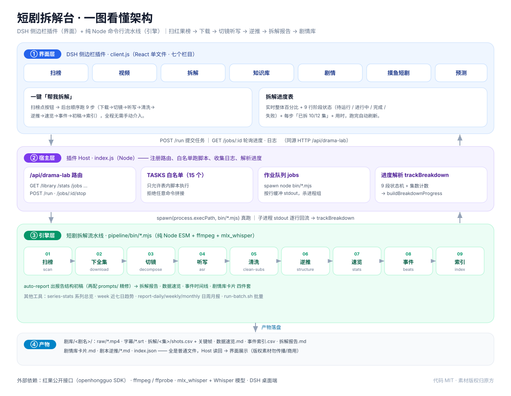

# 制作说明 · 短剧拆解台

> 版本 2026-11-08 ｜ 仓库 <https://github.com/chengyuanjie455-cmd/duanju-chaijietai> ｜ 许可 MIT
>
> 这份文档**一份顶两份**：前四节写给「使用者」（怎么装、怎么用、怎么交接），第五~八节写给「开发者 / 接手维护的人」（架构、代码地图、怎么改、怎么扩）。只想用的话看完第四节就够；要改代码从第五节看起。

---

## 0. 一句话

**短剧拆解台 = 一个 DSH 侧边栏插件（界面）+ 一条纯 Node 命令行流水线（引擎）。**

> 扫红果短剧榜 → 按剧下载 → 抽帧切镜 / 语音听写 → 逐镜逆推剧本 → 产出「单剧拆解报告 / 数据速览 / 事件时间线 / 剧情库卡片」。

插件负责「看和点」，流水线负责「真干活」，两者共用同一个 `pipeline/` 目录，界面从不重复实现引擎逻辑。

```
红果榜单 ──scan──► 排行数据 ──download──► 原片 ──decompose──► 镜头+关键帧
                                   │
                        asr 听写 ──► 字幕 ──structure──► 逐镜逆推稿
                                   │
                 stats 数据速览 · beats 事件索引 · auto-report 初稿
                                   │
                            index 剧情库索引 ──► 拆解台界面浏览 / 报告
```

---

## 1. 它由哪两半组成

| 半身 | 目录 | 技术 | 职责 |
| --- | --- | --- | --- |
| **界面插件** | `plugin/` | DSH 插件（Host 侧 Node + Web 侧 React 单文件） | 左侧边栏七个栏目、点按钮跑任务、读 `剧库/` 展示 |
| **命令行引擎** | `pipeline/` | 纯 Node ESM（`.mjs`）+ ffmpeg + mlx_whisper | 真正下载 / 切镜 / 听写 / 逆推 / 出报告 |

插件**不内置**任何下载、解密、听写逻辑，只做两件事：读流水线目录、在 Host 侧 `spawn node bin/*.mjs`。

---

## 2. 能做什么

### 七个栏目

| 栏目 | 内容 |
| --- | --- |
| 扫榜 | 红果 32 个榜按日期浏览，频道切换、名次/热度/集数，联动库内已有剧目 |
| 视频 | 逐集原片播放（支持 Range 拖动）、五宫格缩略图、当集时长/镜头/字数/首末句 |
| 拆解 | 逐镜表 + 关键帧 + 台词对齐；报告/速览/卡片/逆推四份文档页签 |
| 知识库 | 跨剧模式库（`剧库/剧情库.md`）+ 各剧剧情库卡片 + 系列总览 |
| 剧情 | 剧情结构逆推、事件时间线、分集表、系列总报告 |
| 摸鱼短剧 | 在线看红果：推荐流 / 搜索 / 分集列表 / 直连播放（不落盘），可一键「下载到拆解库」 |
| 预测 | 透明经验打分器：按已拆剧目的语料 z 分数打分，给出 band、驱动项、最像的对标 |

### 两个「招牌动作」

1. **帮我拆解（一键全流程）**：扫榜页每部剧后面点「帮我拆解」，后台跑完 9 个步骤，**并弹出一张拆解进度表**实时显示：整体百分比 + 9 行阶段（`⏸待运行 / ⏳进行中 / ✅完成 / ❌失败`）+ 每步进度（如「已拆 10/12 集」）+ 用时。详见 §5.4。
2. **运行流水线抽屉**：顶部「运行」按钮，手动挑单步（扫榜/下载/切镜/听写/逆推/速览/事件索引/系列总览），日志每 2 秒回流。

---

## 3. 快速上手（使用者）

### 3.1 环境

- **Node.js ≥ 20**
- **ffmpeg / ffprobe**（`brew install ffmpeg`，macOS 默认在 `/opt/homebrew/bin`）
- **mlx_whisper**（`pip install mlx-whisper`；目前只在 Apple Silicon 顺畅）+ 本地 Whisper 模型
- **openhongguo**（红果公开接口 SDK，`npm install` 会自动装）

### 3.2 装依赖 + 下模型

```bash
cd pipeline
npm install

# Whisper 模型（ModelScope 镜像，无需 HuggingFace 账号，约 1.5G）
mkdir -p models/whisper-large-v3-turbo && cd models/whisper-large-v3-turbo
for f in config.json weights.safetensors; do
  curl -L -C - -o "$f" \
    "https://www.modelscope.cn/api/v1/models/mlx-community/whisper-large-v3-turbo/repo?Revision=master&FilePath=$f"
done
cd ../..
```

### 3.3 两种用法，任选其一

**A. 只用命令行（不需要 DSH）**

```bash
cd pipeline
node bin/scan.mjs                                        # 01 扫榜
node bin/download.mjs --series <剧目ID> --name "某剧"     # 02 下全集
node bin/decompose.mjs --series "某剧"                    # 03 切镜
node bin/asr.mjs --series "某剧"                          # 04 听写（可加 --prompt "人名,地名"）
node bin/clean-subs.mjs --series "某剧"                   # 04b 清洗字幕
node bin/structure.mjs --series "某剧"                    # 05 逆推稿
node bin/stats.mjs --series "某剧"                        # 05b 数据速览
node bin/beats.mjs --series "某剧"                        # 07 事件索引
node bin/index.mjs                                        # 06 刷新剧情库索引

# 一条命令跑完 ↓（= 下载→切镜→听写→清洗→逆推→速览→事件→初稿→索引）
node bin/breakdown.mjs --series <剧目ID> --name "某剧"
```

批量：编辑 `series.example.txt`，每行 `剧名|剧目ID|提示词`，然后 `./bin/run-batch.sh ../series.example.txt`。

**B. 接桌面版界面（有 DSH）**

```bash
# 在 DSH 的 desktop profile 里加入插件（路径换成你克隆后的 plugin/ 绝对路径）
dsh plugin --profile desktop add /绝对路径/short-drama-lab/plugin
```

或手动编辑 `~/.dsh/profiles/desktop/package.json`：

```jsonc
{
  "dependencies": { "dsh-drama-lab": "file:/绝对路径/short-drama-lab/plugin" },
  "dsh": { "profile": { "bundles": [ /* …, */ "dsh-drama-lab" ] } }
}
```

然后**重启 DSH**（Host 侧插件在启动时装配），左侧图标行出现「短剧拆解台」。

### 3.4 必配项：`pipelineRoot`

插件要知道引擎在哪。编辑 `plugin/cordis.patch.yml`：

```yaml
- insert:
    - id: drama-lab
      name: dsh-drama-lab
      config:
        pipelineRoot: /绝对路径/short-drama-lab/pipeline
        maxLogLines: 400
```

也可用环境变量覆盖：`export DSH_DRAMA_LAB_ROOT=/绝对路径/short-drama-lab/pipeline`。

> ⚠️ **不改 `pipelineRoot` = 插件找不到引擎，点了没反应。这是头号坑。** 改了之后必须重启 DSH。

---

## 4. 产出长什么样

以某剧为例，跑完 `剧库/` 下是：

```
剧库/
├── 某剧/
│   ├── raw/EP001.mp4 …                 # 原片
│   ├── meta.json                       # 剧目元信息（ID/集数/热度…）
│   ├── 字幕/EP001.srt … 全集字幕.md
│   ├── 拆解/
│   │   ├── EP001/shots.csv  shots/*.jpg  contact.jpg   # 逐镜表 + 关键帧 + 九宫格
│   │   ├── 数据速览.md  stats.json
│   │   ├── 事件索引.csv  事件时间线.md
│   │   └── 拆解报告.md  剧情结构逆推.md  剧情库卡片.md
│   ├── 剧本逆推/EP001.md …  分集表.csv
│   └── 剧情库卡片.md
├── README.md / index.json               # 剧情库索引（index.mjs 生成）
└── 剧情库.md                            # 跨剧模式库
```

> 「可复算的统计」（时长/镜头/密度/首末句）由脚本保证；「分析判断」类（拆解报告/剧情结构/卡片）是 `auto-report.mjs` 先出结构初稿，再配 `pipeline/prompts/` 的写作契约人工精修。示例见 `docs/SAMPLE_OUTPUT.md`。

---

## 5. 原理与架构（开发者）

### 5.1 三层数据流



（上面这张图也存了 PNG：[docs/architecture.png](./docs/architecture.png)；README 顶部同样内嵌了它。）

```
┌────────────── Web 侧 client.js（React 单文件）──────────────┐
│ 七个栏目组件 + 流水线抽屉 + 拆解进度卡片                      │
│ 只发 fetch 到 /api/drama-lab/*，从不直接碰文件系统            │
└───────────────────────────┬──────────────────────────────┘
                            │ HTTP（同源）
┌───────────────────────────▼──────────────────────────────┐
│ Host 侧 index.js（Node）                                    │
│ · 注册 prefix 路由 /api/drama-lab                            │
│ · 读 剧库/ data/ reports/ 给前端 JSON                        │
│ · 白名单 TASKS → spawn(process.execPath, bin/*.mjs)          │
│ · 作业队列 jobs：收集 stdout，解析阶段进度                    │
└───────────────────────────┬──────────────────────────────┘
                            │ child_process.spawn
┌───────────────────────────▼──────────────────────────────┐
│ pipeline/bin/*.mjs（真正的引擎，纯命令行）                    │
│ 产物全部落成普通文件：csv / md / srt / json / jpg             │
└──────────────────────────────────────────────────────────┘
```

**为什么这样分层**：界面永远只跟 Host 的 JSON 打交道，引擎始终是「可单独在终端跑」的脚本。好处是——命令行能用、界面能用，改界面不动引擎，改引擎不动界面，也方便你绕过界面直接排错。

### 5.2 Host 侧 `plugin/index.js`

- 导出 `name = 'dsh-drama-lab'`；入口 `apply(ctx, config)`：
  ```js
  export function apply(ctx, config = {}) {
    const root = resolveRoot(config)      // 解析 pipelineRoot（config 或 DSH_DRAMA_LAB_ROOT 或默认）
    const jobs = createJobs(config)       // 作业队列
    ctx.inject(['webServer'], (web) => {
      // 以 prefix 方式挂载 PREFIX='/api/drama-lab'
    })
  }
  ```
- **`TASKS` 白名单**（index.js:23）：每个可跑任务 = `{ script, title, args(query) }`。`args()` 把前端 query 翻译成 CLI 参数。**不在表里的 task 一律拒绝**，杜绝任意命令执行。已含：scan / download / decompose / asr / structure / stats / beats / index / series-stats / week / report-daily / report-weekly / report-monthly / auto-report / breakdown。
- **`createJobs(config)`**（index.js:170 附近）返回 `{ start, get, list, stop }`：
  - `start(root, task, query)`：拼 `args = [script, ...spec.args(query)]`，建 job 对象（`id: job-N`、lines、running、startedAt、code…），清代理环境变量（`ALL_PROXY/all_proxy`），设 `OHG_PROFILE` / `HF_HUB_OFFLINE=1` / `PYTHONUNBUFFERED=1`，再 `spawn(process.execPath, args, { cwd: root, env })`。
  - stdout/stderr 的 `data` 进入 `push()`：**按行缓冲**（`job.buffer` 保存半行），逐行 `job.lines.push` 并调 `trackBreakdown()` 解析进度；`child.on('close')` 前 `flush()` 吐出最后残行，并 `push('[exit <code>]')`。
  - `list()` 按开始时间倒序取最近 12 个，附 `tail: lines.slice(-40)` 与 `argv`。
  - `stop(id)` → `process.kill(-pid, 'SIGTERM')`（杀整个进程组）。
- **HTTP 路由**（同源 `/api/drama-lab`）：`GET /config`、`GET /library`、`GET /stats`、`GET /reports`、`GET /report`、`GET /series-report`、`GET /series-overview`、`GET /jobs`、`GET /jobs/:id`、`POST /run`、`POST /jobs/:id/stop`。
- `POST /run`：校验 task 在白名单内；`breakdown` 额外要求 `seriesId` 匹配 `/^\d{6,}$/`、`dramaName` 非空；其余按 `TASKS[task].args(query)` 组装。返回 `{ job }`（含 id 供前端轮询）。

### 5.3 Web 侧 `plugin/client.js`

单文件、不打包，靠 DSH 的模块加载器：

```js
window.__ModuleLoader__.load({
  id: 'dsh-drama-lab',
  factory(require) {
    const React = require('react')
    const h = React.createElement
    // ...定义组件...
    return { inject: ['slots'], apply(ctx) {
      ctx.slots.inject('main', () => ctx.slots.register({ name:'main', key:'drama-lab' }, Panel))
      ctx.slots.inject('sidebar.panellist', () => ctx.slots.register(
        { name:'sidebar.panellist', id:'drama-lab', order:6, label:()=>'短剧拆解台' }, RailIcon))
    }}
  }
})
```

组件清单（client.js 行号）：

| 组件 | 行 | 作用 |
| --- | --- | --- |
| `Markdown` / `Spark` / `Err` | 260 / 280 / 256 | 轻量 Markdown、迷你折线、错误条 |
| `HongguoView` | 310 | 摸鱼短剧（在线看红果） |
| **`BreakdownProgress`** | **440** | **拆解进度卡片（进度表）** |
| `RankingView` | 488 | 扫榜（含「帮我拆解」按钮） |
| `VideoView` | 705 | 逐集原片播放 |
| `BreakdownView` | 744 | 逐镜表 + 四份文档页签 |
| `KnowledgeView` | 826 | 知识库 / 系列 |
| `StoryView` | 868 | 剧情结构 / 事件时间线 / 分集表 |
| `ForecastView` | 932 | 预测打分 |
| `PipelineDrawer` | 1038 | 顶部「运行」抽屉（单步任务 + 日志） |
| `Panel` | 1116 | 总面板：栏目切换、剧库加载、进度卡片挂载 |
| `RailIcon` | 1211 | 侧边栏图标 |

### 5.4 「一键拆解进度表」是怎么实现的（重点）

需求是：点「帮我拆解」后，不能只显示「运行中…」，要有一张能看清每一步的进度表。实现分四段：

**① 引擎按时打点（breakdown.mjs 既有日志）**
`breakdown.mjs` 顺序 spawn 9 步，每步前打印 `[breakdown] ▶ <label>`，成功打印 `[breakdown] 完成：<NAME>（iso）`，失败打印 `[breakdown] 失败：<label> 退出码 <code>`。子进程自身的逐集日志也直通上来（如 `[3/12] EP003 ✓`、`EP003 92s → 47 镜`、`EP003 ✓ 12s，345 字`）。

**② Host 把日志解析成结构化进度（index.js）**

- `BREAKDOWN_STAGES`（index.js:175）：9 个中文 label 的固定顺序。
- `trackBreakdown(job, line)`（index.js:198）：逐行喂入状态机——
  - 见 `▶ label` → 前一段置 `done`、该段置 `running` 并记 `startedAt`；
  - 见 `失败` → 当前段置 `error`，错误信息取 `[breakdown]` 之后、去 `[breakdown] 失败：` 前缀；
  - 见 `完成` → `job.progressFinished = true`，全部置 `done`；
  - 运行中按段解析「已完成/总数」：下载用 `/\[(\d+)\/(\d+)\]\s*EP/`、切镜用 `/EP\d+\s+\d+(?:\.\d+)?s\s*→\s*\d+\s*镜/`、听写用 `/EP\d+\s+[✓✗]/`、逐镜逆推用 `/EP\d+\s*→\s*\d+\s*镜/`；单步阶段取该行文本（去时间戳、去 `[tag]` 前缀）做 48 字摘要。
- `buildBreakdownProgress(job)`（index.js:290）：把 `job.stages` 汇总成 `{ percent, finished, error, stages:[{label,status,done,total,detail,seconds}] }`；percent 按「完成段=1 / 进行中段=分数 / 总 9 段」加权，完成时 100。
- `GET /jobs/:id` 响应里带上 `progress`（非 breakdown 任务为 `null`）。

**③ 前端渲染进度卡（client.js）**
`BreakdownProgress({ job, onClose })`（client.js:440）读 `job.progress`，画 8px 渐变进度条 + 一行状态 + 表格：`# / 步骤 / 状态 / 进度 / 用时`，状态用 `⏸待运行 ⏳进行中 ✅完成 ❌失败` 上色。没有 `stages` 时显示「已提交，正在获取进度…」。

**④ 面板驱动轮询（client.js `Panel`）**
`startBreakdown(payload,label,title)`（client.js:1137 附近）：`POST /run` 拿到 `job.id` → `setBd(job)`；一个 effect（依赖 `[bd?.id]`）每 **1.5 秒** `GET /jobs/:id` 更新 `bd`；`!running` 时若 `code===0` 则 `loadLibrary()` 刷新剧库。卡片挂在 body 顶部，所有栏目都可见。

> 顺手修的历史 bug：老代码轮询判的是 `job.exitCode`（服务端返回字段其实是 `code`），导致永远不结束/不刷新；现已统一用 `job.running` + `job.code`。

### 5.5 流水线各脚本职责 + 日志契约

| 脚本 | 阶段 | 干什么 | 关键日志（进度解析依赖） |
| --- | --- | --- | --- |
| `scan.mjs` | 01 | 抓 32 榜 → `data/rankings` + `reports/*.md` | `[scan] …` |
| `download.mjs` | 02 | 下全集 → `剧库/<剧>/raw/EPxxx.mp4` + `meta.json` | `[i/N] EPxxx ✓ …` / `✗ 第k次：…` / `[done] 新下 X…` |
| `decompose.mjs` | 03 | ffmpeg 场景切分 + 抽帧 + 九宫格 | `EPxxx 92s → 47 镜…` |
| `asr.mjs` | 04 | 本地 Whisper 听写 → `字幕/EPxxx.srt` | `EPxxx ✓ 12s，345 字` |
| `clean-subs.mjs` | 04b | 清洗字幕（去复读、统一标点） | `[clean] …` |
| `structure.mjs` | 05 | 逐镜逆推稿 → `剧本逆推/EPxxx.md` | `EPxxx → 47 镜 / 345 字` |
| `stats.mjs` | 05b | 数据速览（秒/镜、切镜率、台词密度） | `[stats] …` |
| `beats.mjs` | 07 | 8 类关键词打标签 → `事件索引.csv` | `[beats] …` |
| `series-stats.mjs` | 08 | 多季汇总对比 | `[series-stats] …` |
| `index.mjs` | 06 | 刷新剧情库索引 `README.md` + `index.json` | `[index] N 部 → …` |
| `breakdown.mjs` | — | 一条命令跑完 02→06 | `▶ label` / `完成` / `失败` |
| `auto-report.mjs` | — | 报告结构初稿（配 `prompts/` 精修） | `[auto-report] …` |
| `week.mjs` / `report-daily/weekly/monthly.mjs` | — | 本周 / 日 / 周 / 月报 | — |

> 阶段 label 顺序固定为：`下载全集 → 切镜抽帧 → 语音听写 → 清洗字幕 → 逐镜逆推 → 数据速览 → 事件索引 → 自动初稿 → 重建剧库索引`。改 `breakdown.mjs` 的步骤或 label 时，**必须同步** `BREAKDOWN_STAGES`（见 §7.3）。

---

## 6. 代码地图

| 文件 | 说明 |
| --- | --- |
| `plugin/index.js` | Host 侧：`TASKS`(23) / `resolveRoot`(~85) / `createJobs`(~170) / `BREAKDOWN_STAGES`(175) / `trackBreakdown`(198) / `buildBreakdownProgress`(290) / 路由(452~992) / `apply`(文件尾) |
| `plugin/client.js` | Web 侧：`TABS`(11) / 各栏目组件（见 §5.3 表）/ `BreakdownProgress`(440) / `Panel`(1116) / `RailIcon`(1211) |
| `plugin/cordis.patch.yml` | 注入配置（★ `pipelineRoot` / `maxLogLines`） |
| `plugin/package.json` | 导出 `.`（Host）与 `./client`（Web）；cordis 元数据 |
| `pipeline/bin/*.mjs` | 引擎（见 §5.5） |
| `pipeline/prompts/*.md` | 报告写作契约：单剧拆解报告 / 季报写作 / 系列总报告 |
| `pipeline/package.json` | 依赖 `openhongguo`；各 `npm run` 快捷入口 |
| `docs/SETUP.md` | 安装配置详解 |
| `docs/ARCHITECTURE.md` | 数据流与脚本职责 |
| `docs/FAQ.md` | 常见问题 |
| `docs/SAMPLE_OUTPUT.md` | 产出示例 |
| `HANDOVER.md` | 打包交接时的「先看这份」 |

---

## 7. 二次开发指南

### 7.1 加一个可运行的单步任务

1. 在 `pipeline/bin/` 写好脚本 `foo.mjs`（遵守约定：参数用 `--xxx`，进度打 `[foo] …` 行）；
2. `plugin/index.js` 的 `TASKS` 里加一项：
   ```js
   foo: { script: 'foo.mjs', title: '我的任务', args: (q) => ['--series', q.name] },
   ```
3. 前端的按钮/抽屉里 `POST /run { task:'foo', ... }` 即可，日志会自动回流。

> 安全边界：**只有 `TASKS` 里的 script 能被执行**，所以别把「按前端字符串拼路径」的逻辑写进来。

### 7.2 加一个栏目

1. `client.js` 的 `TABS`(11) 加 `{ id:'my', label:'我的' }`；
2. 写一个 `function MyView(props){ … }`（用 `getJson('/xxx')` 拿数据）；
3. 在 `Panel` 的 body 分支里把 `tab === 'my'` 指向它；
4. 若需要新数据，在 `index.js` 的 `handle()` 里加 `GET /xxx`（注意 `path` 前缀已被剥掉）。

### 7.3 扩展进度表

- **只改文案/顺序**：改 `BREAKDOWN_STAGES`（index.js:175）。
- **步骤数变了**（比如 `breakdown.mjs` 新增一步）：`BREAKDOWN_STAGES` 同步加 label，`trackBreakdown` 用 `▶ label` 自动对齐，无需改结构；`buildBreakdownProgress` 的 percent 会按新段数均分。
- **某步想显示「已完成/总数」而不是摘要**：在 `trackBreakdown` 对应分支里加一条正则解析，写入 `cur.done/cur.total`。
- 前端 `BreakdownProgress` 会自动按 `stages` 数组渲染，无需改。

### 7.4 本地调试 / 部署

```bash
# 语法自检（改完必做）
for f in pipeline/bin/*.mjs; do node --check "$f"; done
node --check plugin/index.js && node --check plugin/client.js

# 单测进度解析（把纯函数切出来跑，参考仓库历史的 /tmp 测试思路）
# 用假 pipeline 做端到端：把 pipelineRoot 指向一个只 echo 日志的假 bin/ 目录，POST /run 后轮询 /jobs/:id
```

- 插件是 Host 侧装配：**改完 `index.js` 必须重启 DSH** 才生效（Web 侧 `client.js` 一般刷新页面即可，取决于宿主缓存）。
- 发布：`git push` 到 GitHub 即可；这是纯源码仓库，不需要构建产物。

---

## 8. 配置项与环境变量

| 位置 | 键 | 作用 | 默认 |
| --- | --- | --- | --- |
| `cordis.patch.yml` | `pipelineRoot` | 流水线目录（★必配） | 见 `resolveRoot` 回退 |
| `cordis.patch.yml` | `maxLogLines` | 每个作业保留日志行数 | 400（夹在 80–4000） |
| env | `DSH_DRAMA_LAB_ROOT` | 覆盖 `pipelineRoot` | — |
| env | `OHG_PROFILE` | 匿名设备档案 | `<pipeline>/data/ohg-profile.json` |
| env | `FFMPEG` / `FFPROBE` | ffmpeg 路径 | `/opt/homebrew/bin/ffmpeg(probe)` |
| env | `MLX_WHISPER` | mlx_whisper 可执行 | `~/.local/bin/mlx_whisper` |
| env | `WHISPER_MODEL` | Whisper 模型目录 | `<pipeline>/models/whisper-large-v3-turbo` |
| env | `WHISPER_PROMPT` | 默认人名/术语提示词 | 空 |

---

## 9. 常见问题（高频）

- **点了没反应** → `pipelineRoot` 没配 / 配错，或没重启 DSH。见 §3.4。
- **`openhongguo` 相关报错（anonymous … empty）** → 首次会自动注册匿名设备；失败多为网络，删掉 `data/ohg-profile.json` 让它重注册。
- **听写报找不到模型 / mlx_whisper** → 按 §3.2 下模型、装 `mlx-whisper`；非 Apple Silicon 请换用其它 Whisper 方案（`WHISPER_MODEL`/`MLX_WHISPER` 指过去）。
- **进度表一直停着不动** → 看该 job 的日志尾部（`GET /jobs/:id` 的 `lines`），多半是某步真卡住/报错；失败时进度表会标 ❌ 并给退出码。
- **预测栏目是空的** → 冷启动正常，需要先拆解几部剧攒语料。

更多见 `docs/FAQ.md`。

---

## 10. 交接清单（把包发给别人时）

1. 解压后先读 `HANDOVER.md`（一页版上手）；
2. 装环境：Node≥20、ffmpeg、mlx_whisper；
3. `cd pipeline && npm install`；
4. 界面版：改 `cordis.patch.yml` 的 `pipelineRoot` → 重启 DSH；
5. 自检：`for f in pipeline/bin/*.mjs; do node --check "$f"; done`。
6. **不要**把 `剧库/`、`models/`、`data/ohg-*.json`、`reports/`、`logs/` 一起发（体积/版权/设备凭据，`.gitignore` 已排除）。

---

## 11. 许可与合规

- 代码：**MIT**（见仓库根 `LICENSE`），可自由使用、修改、分发。
- `openhongguo`：其自身授权（Apache-2.0）。
- **影视素材版权归原平台/版权方**。本工具仅用于**个人学习、研究与创作参考**；请勿传播原片/字幕/关键帧，请勿商用或二次上传。
